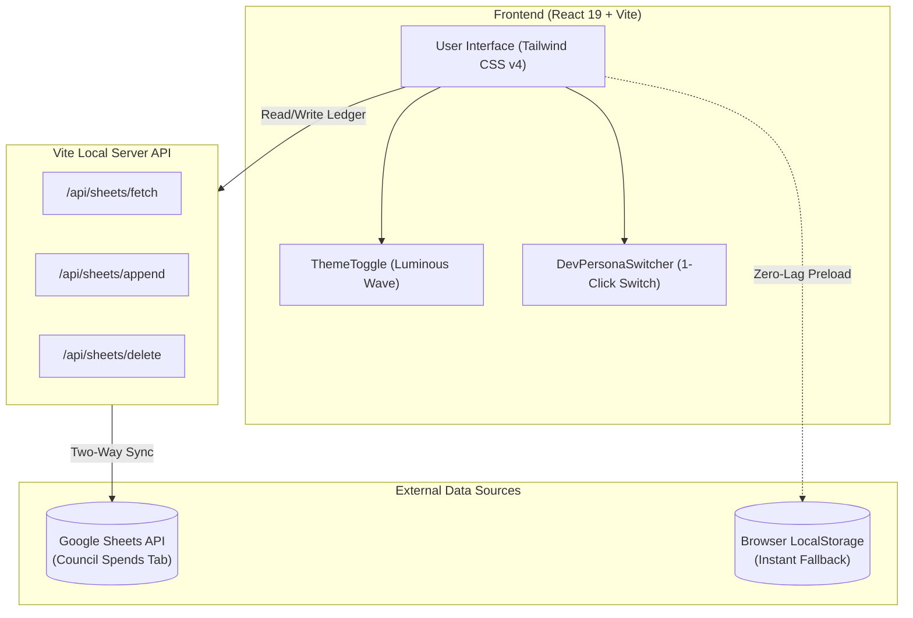

<div align="center">

# 🏛️ Scaler Transparency Hub
### Governance, Treasury Ledger & Event Management System
**Scaler School of Business (SSB) • Student Council & Clubs**

[](https://react.dev/)
[](https://vitejs.dev/)
[](https://tailwindcss.com/)
[](https://www.framer.com/motion/)
[](https://developers.google.com/sheets/api)
[](https://vercel.com/)

[Budget Guidelines](#-official-budget-guidelines-enforcement) • [System Architecture](#-system-architecture) • [Role Matrix](#-role-based-access-control-rbac-matrix) • [Local Setup](#-getting-started)

</div>

---

## 📌 Overview

The **Scaler Transparency Hub** is an institutional governance and financial audit platform built for the **Scaler School of Business (SSB)** cohort. It eliminates opaque spreadsheets, fragmented WhatsApp approvals, and password fatigue by providing:

1. **Live Two-Way Google Sheet Sync:** Financial entries and deletions in the portal write directly to and from the official `Council Spends` workbook.
2. **Multi-Signature 3-Key Sign-Off:** Mandates approval by **Ashil**, **Madhur**, and **Spandan** before any event budget or calendar booking is committed.
3. **Itemised Budget Tracking:** Enforces the ₹2,50,000 Student Council pool and ₹20,000 per-club annual budget caps.
4. **Student Townhall & Anonymous Forum:** An open channel for anonymous cohort ideas, infrastructure tickets, and interactive real-time polls.
5. **Instant-Load Engine (~0ms):** Synchronous cache-first state hydration and timeout guards eliminate network cold-start lag.

---

## 📸 Interface Snapshots & UI Walkthrough

### 1. Hub Overview & Treasury Health
> Real-time financial telemetry showing available balance, cumulative burn rate, active townhall issues, and upcoming calendar schedules.

```
+---------------------------------------------------------------------------------------+
|  🏛️ SCALER SSB COHORT HUB            [POV: Spandan (Treasurer)]  [🔔 2]  [🌙 Night]   |
+---------------------------------------------------------------------------------------+
|  ✨ COHORT GOVERNANCE OPERATIONS                                                      |
|  Welcome back, Spandan                                                                |
|  Logged in as Treasurer & Budget Owner. Real-time ledger & sheet sync active.         |
|                                                                                       |
|  +------------------------+  +------------------------+  +------------------------+   |
|  | AVAILABLE TREASURY     |  | SCHEDULED EVENTS       |  | TOWNHALL PULSE         |   |
|  | ₹1,80,333.25           |  | 2 Approved             |  | 1 Active / 2 Resolved  |   |
|  | Pool: ₹2,50,000        |  | Next: Product Hackathon|  | Live cohort sentiment  |   |
|  +------------------------+  +------------------------+  +------------------------+   |
+---------------------------------------------------------------------------------------+
```

---

### 2. Live Google Sheets Two-Way Finance Ledger
> Matches every column of the official `Council Spends` spreadsheet (Date, Event Header, Description, Vendor, Entity, Qty, Unit Price, Total, Paid By, Receipt Link, Notes).

```
+---------------------------------------------------------------------------------------+
|  📊 Google Sheet Live Sync  [Two-Way Active]               [🔄 Sync Sheet] [↗ Open]  |
|  Synced with: Council Club Budget Tracker (Council Spends Tab)                        |
+---------------------------------------------------------------------------------------+
|  STUDENT COUNCIL CAP: ₹2,50,000                                                       |
|  ₹69,666.75 Spent (27.9%) [========================-----------------]                 |
|                                                                                       |
|  CLUB ALLOCATIONS (₹20,000 each per Guideline 1):                                     |
|  [Product Club: ₹0/20k] [Strategy: ₹0/20k] [Academics: ₹0/20k] [Sports: ₹0/20k]        |
+---------------------------------------------------------------------------------------+
|  LOG EXPENSE (Spandan Only):                                                          |
|  [Date: 2026-11-06] [Event: Week 1 Cohort Connect v] [Entity: Student Council v]     |
|  [Item: Amphitheatre Stage Audio] [Vendor: Zepto] [Qty: 1] [Unit: 4500] [Total: 4500]|
|  [Paid By: Spandan] [Reimbursement?: No v] [Bill/Drive Link: drive.google.com/... *] |
|  [Commit to Ledger & Write to Google Sheet]                                           |
+---------------------------------------------------------------------------------------+
```

---

### 3. Multi-Signature Event Planner (Ashil, Madhur & Spandan)
> Propose events with itemised budget estimates; proposals move to the Official Calendar only when all 3 approvers place their cryptographic signatures.

```
+---------------------------------------------------------------------------------------+
|  ⚠️ NEEDS 3-KEY APPROVAL (1)                                  [Mandatory Guideline 2]  |
|  2026-11-12 • Est. Budget: ₹15,000                                                    |
|  Product Management Hackathon (Case challenge, goodies & speaker cabs)                |
|                                                                                       |
|  [ Ashil: APPROVED ✅ ]     [ Madhur: APPROVE ✍️ ]     [ Spandan: PENDING ⏳ ]        |
|  (Council Approver 1)       (Council Approver 2)        (Budget Owner)                |
+---------------------------------------------------------------------------------------+
|  📅 OFFICIAL APPROVED CALENDAR                                                         |
|  [ 20 NOV ] Venture Capital & Founders Panel (Budget: ₹8,000) [Revoke]                |
+---------------------------------------------------------------------------------------+
```

---

### 4. Day / Night Luminous Capsule Switch
> Custom-engineered day/night capsule toggle with tactile spring physics and a soft, luminous radial wave transition.

```
   Night Mode (Obsidian & Stars)               Day Mode (Warm Sunbeam)
   +---------------------------+               +---------------------------+
   |  *  .  ✨      ( 🌙 )     |     <--->     |     ( ☀️ )      .   ☀     |
   +---------------------------+               +---------------------------+
        Indigo Glow Knob                            Amber-Gold Glow Knob
```

---

## 🏛️ Official Budget Guidelines Enforcement

The application natively hardcodes and automates the **Student Council & Club Budget Guidelines**:

| Guideline | Policy Requirement | Portal Implementation |
| :--- | :--- | :--- |
| **Section 1: Council Budget** | Total allocation: **₹2,50,000** until 31 August 2027. | Real-time burn-rate bar, balance meter, and event header grouping. |
| **Section 1: Club Budget** | Total allocation: **₹20,000 per club per year**. | Dedicated cards for Product, Strategy, Marketing, Finance, Academics, and Sports. |
| **Section 2: Approvals** | Reviewed and approved by **Ashil, Madhur, and Spandan**. | 3-Key multi-signature workflow in the Event Calendar. |
| **Section 2: Ownership** | Spandan takes ownership of overall budget. | Only Spandan / Admin can commit or delete expenses on the official ledger. |
| **Section 3: Planning** | Purpose, format, guest details, and itemised budget. | Mandatory estimated budget and requirements form for all event proposals. |
| **Section 5: Documentation** | Bills or receipts attached or linked for every expense. | Mandatory Google Drive / Invoice URL verification before commit. |

---

## 🔄 System Architecture & Data Flow



---

## 👥 Role-Based Access Control (RBAC) Matrix

| Persona | Role Key | Propose Events | 3-Key Approval | Commit/Delete Ledger | Moderate Townhall |
| :--- | :--- | :---: | :---: | :---: | :---: |
| **Ashil** | Council Approver 1 | ✅ | ✅ (1st Key) | View Only | ✅ |
| **Madhur** | Council Approver 2 | ✅ | ✅ (2nd Key) | View Only | ✅ |
| **Spandan** | Budget Owner / Treasurer | ✅ | ✅ (3rd Key) | ✅ (Full Ledger) | ✅ |
| **Club Leads (Pres/VP)** | `club_lead` (Academics, Sports, Product, etc.) | ✅ | ❌ | View Only | View / Vote |
| **Cohort Member** | `student` | ❌ | ❌ | View Only | View / Vote / Post |
| **System Admin** | `admin` | ✅ | ✅ (Overrides) | ✅ (Full Ledger) | ✅ |

---

## 🚀 Getting Started

### Prerequisites
* **Node.js**: v18.0.0 or higher
* **npm**: v9.0.0 or higher

### Installation

```bash
# Clone the repository
git clone https://github.com/chirag478/scaler-hub.git

# Navigate into the frontend workspace
cd scaler-hub/frontend

# Install dependencies
npm install
```

### Running Locally

```bash
# Start the local development server with Google Sheets API middleware
npm run dev
```

Open **http://localhost:5173** in your browser.

### Building for Production

```bash
# Compile and optimize for production
npm run build
```

---

## 🛠️ Tech Stack

* **Core Framework:** [React 19](https://react.dev/) + [Vite 8](https://vitejs.dev/)
* **Styling & Design System:** [Tailwind CSS v4](https://tailwindcss.com/)
* **Motion & Micro-interactions:** [Framer Motion 14](https://www.framer.com/motion/)
* **Iconography:** [Lucide React](https://lucide.dev/)
* **Integrations:** Google Sheets API, Supabase JS Client
* **Deployment:** [Vercel](https://vercel.com/)
